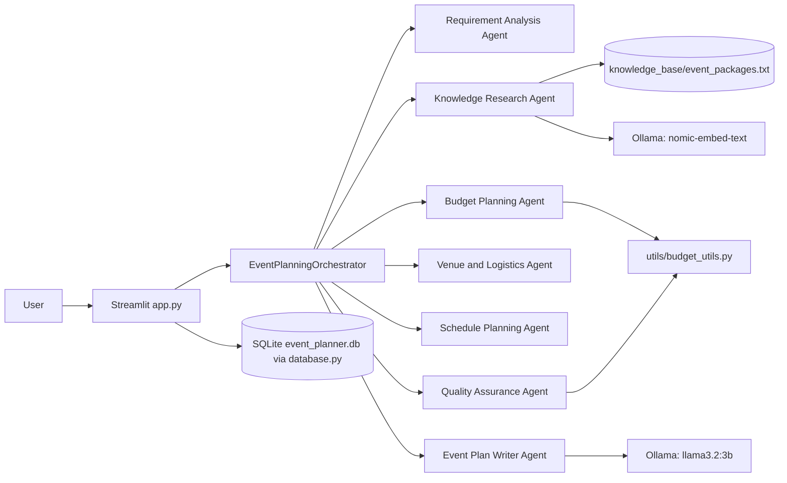
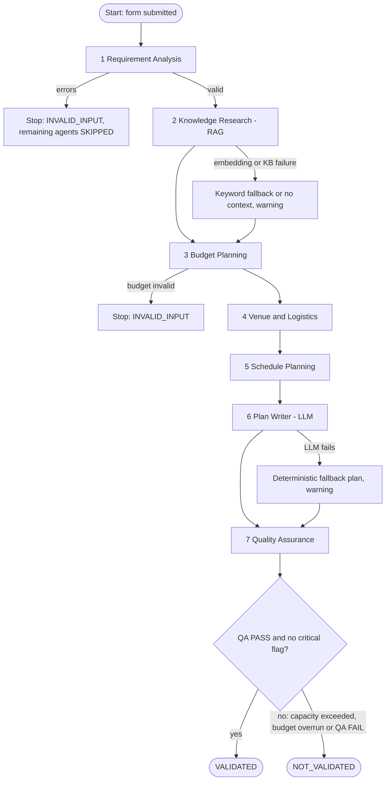

# Smart Event Planning Agent
**An Autonomous Multi-Agent AI Platform with Retrieval-Augmented Generation (RAG) and Deterministic Constraint Validation**

A local, web-based application (Streamlit) that plans weddings, birthdays, engagements, anniversaries, naming
ceremonies and corporate events. Seven specialised agents cooperate under an orchestrator, using a local LLM
(Ollama `llama3.2:3b`), local embeddings (`nomic-embed-text`), NumPy cosine similarity and SQLite.

> **What this app does and does not do.** It *creates event plans and stores them locally*. It does **not**
> book venues, contact vendors, check real availability or process payments. All prices in the knowledge base
> and budget splits are **illustrative estimates**, not vendor quotations.

> **About "autonomy".** The workflow is a rule-driven multi-agent pipeline. The order of agents and the
> decisions after failures are **deterministic orchestration rules (R1-R6)** written in Python. The LLM is used
> for writing the plan text; budget, capacity and QA checks are deterministic Python code. The system plans,
> retrieves, uses tools, and routes conditionally, but it does not re-plan itself freely like a general
> autonomous agent.

---

## 1. Installation on Windows

### 1.1 Install Python
Install Python 3.10 or newer from python.org (tick **"Add Python to PATH"**). Check in a terminal:
```powershell
python --version
```

### 1.2 Install Ollama and download the models
1. Install Ollama for Windows from https://ollama.com/download and start it (it runs in the system tray).
2. In a terminal download the two models (a few GB in total):
```powershell
ollama pull llama3.2:3b
ollama pull nomic-embed-text
ollama list
```

### 1.3 Create the virtual environment and install packages
In VS Code open the project folder, then open a terminal (Terminal > New Terminal):
```powershell
python -m venv venv
venv\Scripts\activate
pip install -r requirements.txt
```
If PowerShell blocks activation, run once: `Set-ExecutionPolicy -Scope CurrentUser RemoteSigned`.

### 1.4 Start the app
```powershell
streamlit run app.py
```
Your browser opens at http://localhost:8501. The database file `event_planner.db` is created automatically.

---

## 2. Project structure

```
EventPlanningAgent/
├── app.py                     Streamlit interface (6 pages)
├── agents.py                  Ollama client, 7 agents, orchestrator
├── database.py                SQLite operations
├── requirements.txt
├── README.md
├── .gitignore
├── event_planner.db           created automatically
├── .streamlit/config.toml     pink/lavender theme (Streamlit reads this file)
├── knowledge_base/event_packages.txt
├── utils/__init__.py
├── utils/budget_utils.py      deterministic budget maths
└── tests/test_budget.py, test_validation.py, test_database.py
```

---

## 3. System architecture



## 4. Multi-agent execution flow



### Agent responsibilities
| # | Agent | Type | Role |
|---|-------|------|------|
| 1 | Requirement Analysis | Deterministic | Validates fields, dates, numbers; builds the requirement object |
| 2 | Knowledge Research | RAG (embeddings) | Retrieves relevant knowledge sections |
| 3 | Budget Planning | Deterministic | Splits budget (sum equals total), detects catering overrun |
| 4 | Venue and Logistics | Deterministic | Guests vs capacity, tables/parking/staff estimates |
| 5 | Schedule Planning | Deterministic | Event timeline + dated preparation tasks |
| 6 | Event Plan Writer | LLM | Writes the personalised plan (fallback if LLM fails) |
| 7 | Quality Assurance | Deterministic | Re-verifies everything, returns PASS/FAIL with reasons |

### Orchestration rules
- **R1** Requirement validation fails: stop, no plan (INVALID_INPUT).
- **R2** Knowledge base missing or embeddings fail: continue with keyword fallback or no context.
- **R3** Budget agent fails: stop.
- **R4** Guests exceed capacity or catering overrun: draft the plan but flag it; never VALIDATED.
- **R5** LLM fails or output is unusable: deterministic fallback plan.
- **R6** VALIDATED only if QA is PASS and no critical flag is set.

---

## 5. RAG pipeline

1. **Load** - `KnowledgeResearchAgent.load_chunks()` reads `knowledge_base/event_packages.txt` and splits it into
   sections at every line beginning with `## `. A missing or empty file raises `KnowledgeBaseError`, which becomes a warning.
2. **Embed** - each section is sent to Ollama (`/api/embed`, model `nomic-embed-text`) with the prefix
   `search_document:`. The vectors are stored in a NumPy matrix and cached until the file changes.
3. **Query** - four queries are built from the requirements (event package, decoration, catering, venue/budget/timeline),
   embedded with the prefix `search_query:`.
4. **Search** - `cosine_similarity()` compares every query vector with every section vector (`m @ q / (|m||q|)`).
   The top 2 sections per query are merged, and the 6 best overall are kept.
5. **Return** - sections with title, source, score and text are returned. They feed the Plan Writer prompt and are shown in the UI.
6. **Fallback** - if embeddings fail, simple keyword overlap ranking is used and a warning is recorded.

## 6. Database schema

```
events(id PK, event_type, event_date, location, guest_count, total_budget, venue_capacity,
       theme, food_preference, special_requirements, validation_status, qa_result,
       plan_text, result_json, created_at)

checklist_items(id PK, event_id FK -> events.id ON DELETE CASCADE, task, due_date,
                completed 0/1, updated_at)
```
`result_json` stores the complete orchestrator result so a saved plan can be reloaded with its trace, budget and QA report.
All SQL uses `?` placeholders (parameterized queries).

---

## 7. Testing

### Commands (run from the project folder with the virtual environment active)
```powershell
python -m pytest -v
python -m pytest tests/test_budget.py -v
python -m pytest tests/test_validation.py -v
python -m pytest tests/test_database.py -v
```
The tests do **not** need Ollama: `test_validation.py` uses a `FakeClient` that mocks embeddings and generation.

### What is implemented
| File | Covers |
|------|--------|
| test_budget.py | allocations sum to total (all event types, many totals), invalid budgets, overrun detection, suggestions fix the overrun, INR formatting, spending comparison |
| test_validation.py | valid/missing/invalid requirements, guests vs capacity, schedule order, cosine similarity, retrieval ranking, missing/empty KB, embedding fallback, QA PASS/FAIL cases, orchestrator happy path, capacity failure, overrun, invalid input skipping, LLM fallback |
| test_database.py | auto-created DB, save/get/list/delete, checklist save/update/summary/cascade, SQL-injection text, DB error handling |

### Sample inputs and expected outputs
| Input | Expected |
|-------|----------|
| Wedding, 100 guests, capacity 150, INR 10,00,000, Vegetarian | VALIDATED, allocations sum to 10,00,000 |
| 300 guests, capacity 200 | Venue agent FAILED, status NOT_VALIDATED, QA FAIL |
| INR 1,00,000, 500 guests, Non-Vegetarian wedding | Budget OVERRUN, NOT_VALIDATED, suggestions shown |
| Budget -5 | INVALID_INPUT, agents 2-7 SKIPPED |
| Ollama stopped | Plan from deterministic fallback, writer step WARNING |

### Honest status of the tests
These tests are **implemented**. This README does not claim any result. **Run the commands above yourself** and
record your actual pass/fail output (for example as a screenshot) for your report. Manual end-to-end testing with a
real Ollama model is also required, because the automated tests mock the model.

---

## 8. Troubleshooting

| Problem | Fix |
|---------|-----|
| "Cannot connect to Ollama" | Start the Ollama app or run `ollama serve`; check http://localhost:11434 in a browser |
| "Model ... is not available" | `ollama pull llama3.2:3b` and `ollama pull nomic-embed-text` |
| Embeddings fail with "incomplete embeddings" | Update Ollama (the `/api/embed` endpoint needs a recent version) and re-pull the model |
| Plan generation is very slow | Normal on CPU-only PCs; close other programs and wait 1-3 minutes. The first call loads the model |
| `ModuleNotFoundError: utils` | Run commands from the project root folder (where `app.py` is) |
| `ModuleNotFoundError: streamlit` | Activate the venv (`venv\Scripts\activate`) and run `pip install -r requirements.txt` |
| PowerShell blocks venv activation | `Set-ExecutionPolicy -Scope CurrentUser RemoteSigned` |
| Database problem message | Close other programs using the file; delete `event_planner.db` to start fresh (saved events are lost) |
| Pink theme not applied | Make sure `.streamlit/config.toml` exists in the project root, then restart Streamlit |

---

## 9. Known limitations and future enhancements
**Limitations:** rule-driven orchestration (not free-form autonomous re-planning); illustrative prices only; a 3B model
can produce generic text; QA catches only a limited set of problems; no real vendor/venue integration; single local
user; English only.
**Future work:** let the LLM propose plan revisions that the QA agent re-checks in a loop; larger or real
vendor-approved knowledge bases; PDF export; multi-user accounts; calendar reminders; evaluation of retrieval quality.


**Q12. What are the ethical or practical limits?**
Prices are illustrative estimates and the system does not book or pay for anything. A human must verify all details
with real vendors.
